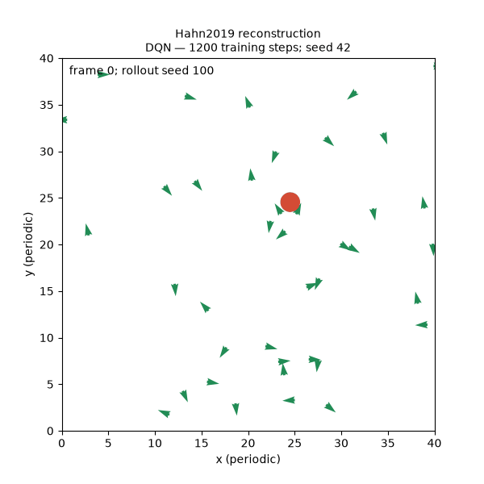

# Emergent Escape-based Flocking — Hahn et al. (2019)

**A from-scratch, approximate paper reconstruction. No author implementation was available to us. This is not an official release or a verified numerical reproduction.** This repository implements both DQN and DDPG, with separate training, frozen-policy evaluation and animation commands. The paper omits ecological parameters that can determine whether flocking emerges; those assumptions are explicit and configurable.

Reference: Carsten Hahn, Thomy Phan, Thomas Gabor, Lenz Belzner and Claudia Linnhoff-Popien, *Emergent Escape-based Flocking Behavior using Multi-Agent Reinforcement Learning*, ALIFE 2019, pp. 598–605. [Paper](https://arxiv.org/abs/1905.04077), [DOI](https://doi.org/10.1162/isal_a_00226).

The experiment asks whether individual survival learning produces groups when a predator can switch among nearby targets. A crucial qualification: the paper reports higher survival for its simple **TurnAway** control than for its learned flocking policies. Flocking, survival and optimality are distinct outcomes here.

## Setup

```bash
./create_conda_env.sh
conda activate ./.conda
python -m pytest -q
```

The setup script creates a private Python 3.11 environment, installs CPU-only PyTorch from its official index, then installs other dependencies from PyPI. This avoids mixing package indexes. The environment is independent of PredPreyGrass and Phan2022. `requirements.txt` is also available for custom environments. Run commands from this repository root. Generated runs are ignored by Git; every run directory must be new.

## Train and evaluate

Bounded smoke runs that execute actual optimizer updates:

```bash
python train.py --algorithm dqn --steps 1200 --env-config configs/smoke.json --output output/dqn_smoke
python train.py --algorithm ddpg --steps 1200 --env-config configs/smoke.json --output output/ddpg_smoke
python evaluate.py --checkpoint output/dqn_smoke/policy.pt --seeds 100 101 --episodes 2 --max-steps 300 --burnin 20 --output output/dqn_smoke_eval
python render_rollout.py --checkpoint output/dqn_smoke/policy.pt --frames 200 --output output/dqn_smoke.gif
```

A run at the reported training-step budget, under our assumed ecology (not an exact paper reproduction):

```bash
python train.py --algorithm dqn --steps 500000 --env-config configs/assumed_environment.json --seed 42 --output output/dqn_500k_s42
python train.py --algorithm ddpg --steps 500000 --env-config configs/assumed_environment.json --seed 42 --output output/ddpg_500k_s42
python evaluate.py --checkpoint output/dqn_500k_s42/policy.pt --n-prey 40 --seeds 100 101 102 --episodes 5 --output output/dqn_500k_eval40
```

Use independent training seeds before interpreting outcomes. The default training budget is 5,000 steps, not 500,000. The smoke configuration additionally shortens episodes to 100 frames and therefore changes how often policies are broadcast. No long experiment is launched by setup.

Evaluation records focal-life episodes and separate fixed-duration population capture rates (`--population-frames`, default 1,000), with exposure-weighted pooling.

Evaluation always includes Random, TurnAway and a local Boids control, plus the learned policy when a checkpoint is supplied. `--no-confusion` disables random target selection while retaining target commitment; `--pinned-predator` holds the predator at its starting position. These are evaluation interventions, not evidence that the learned behavior was caused by confusion: matched retraining and multiple seeds are needed for that claim.

## Implementation and outputs

- `hahn2019/environment.py`: periodic geometry, observations, scripted predator, captures and respawning.
- `hahn2019/learning.py`: independent DQN/DDPG, replay, Bellman targets and target networks.
- `train.py`: learns only from prey slot zero; frozen peer policy is replaced at episode boundaries. No cohesion, alignment, distance-to-neighbor, or Boids reward enters RL.
- `evaluate.py`: frozen, greedy DQN or noise-free DDPG, independent episode initializations, unshaped returns, survival censoring, capture counts and clustering metrics.
- `render_rollout.py`: annotated GIFs. Animation is a continuing respawning population and does not reset on focal death; evaluation episodes do end on focal death.

Training saves `config.json`, `training.json` (completed episodes, partial episode, update/broadcast counts and losses) and `policy.pt`. The checkpoint contains the actor and configuration for inference; optimizer state and replay are not saved, so it does **not** support training resume. Python/NumPy/PyTorch versions are recorded. Evaluation saves raw per-episode records in `evaluation.json`. Results are not pooled into a fabricated significance test.

The runner is sequential and CPU-only. PyTorch initialization/thread settings are process-global; use separate processes and distinct output directories for concurrency. Interrupted runs may contain incomplete artifacts: inspect them and use a new output directory for a rerun.

## Fidelity audit

The [2026-10-21 investigation](FIDELITY_AUDIT.md) identifies historical Keras-RL/default differences, a four-versus-five-neighbor source conflict, initialization diagnostics, ecology sensitivity and a constant-turn collapse in DQN seed 43. It includes reproducible diagnostic scripts and raw results. No learner defaults were changed by the audit.

## Fidelity and limits

The primary paper was read directly, including visual inspection of Table 1. [METHODS.md](METHODS.md) maps each implementation decision to either the paper or an explicit reconstruction assumption. The DQN and DDPG configurations are different, including neighborhood size and batch size. This is a PyTorch rebuild of the described methods, not a Keras-RL compatibility implementation.

[RESULTS.md](RESULTS.md) records executed checks and the independent Codex review. No claim that learned flocking, the published figures, the proposed equilibrium explanation, or superior survival has been reproduced follows from passing tests or short runs. The paper itself presents the equilibrium explanation as a hypothesis.

## Optional DDPG stabilization and progress

The unwrapped seed-42 DDPG run diverged during full-budget training. `--wrap-ddpg-actions` selects an **experimental stabilization variant**: behavior, replay and every critic input use angles in [-180°, 180°), or [-pi, pi) for radian actions. The actor head stays linear and gradients pass through the wrap except at its discontinuities. This changes optimization, so wrapped results must be reported separately from the original reconstruction. The default remains unwrapped for compatibility.

```bash
python train.py --algorithm ddpg --steps 500000 --seed 42 --wrap-ddpg-actions --env-config configs/assumed_environment.json --output output/ddpg_wrapped_s42
```

Numerical guards reject non-finite losses/gradients before each optimizer step. Training writes `progress.json` and `checkpoint_latest.pt` every 5,000 steps (configurable with `--progress-every`). Inference checkpoint metadata records actual completed steps separately from the planned budget. These are inference snapshots, not optimizer/replay resume checkpoints. A numerical failure writes `failure.json`; an earlier complete snapshot remains available. A DDPG critic update may have succeeded before a subsequent actor update fails; the process stops rather than attempting to continue partially updated training.

## Smoke-run preview



An 80-frame display of the seed-42 DQN smoke checkpoint with 40 prey. This is an execution check, not a reproduced flocking result. Green arrows are prey, the orange circle is the predator.

## Attribution

Original implementation for this repository, MIT licensed. The paper is credited as the research source; its PDF and figures are not redistributed. Created with OpenAI Codex assistance, with independent Codex CLI review of nontrivial code. No source code from PredPreyGrass, Phan2022, or an author flocking repository was imported.

To test the historical Keras initialization profile independently of other settings:

```bash
.conda/bin/python train.py --algorithm dqn --steps 500000 --seed 42 \
  --env-config configs/assumed_environment.json \
  --initialization glorot_zero_bias --output output/dqn_glorot_s42
```

The default is `torch_default`; older checkpoint metadata remains supported.
See `RESULTS.md` for the controlled two-seed experiment protocol and limitations.
